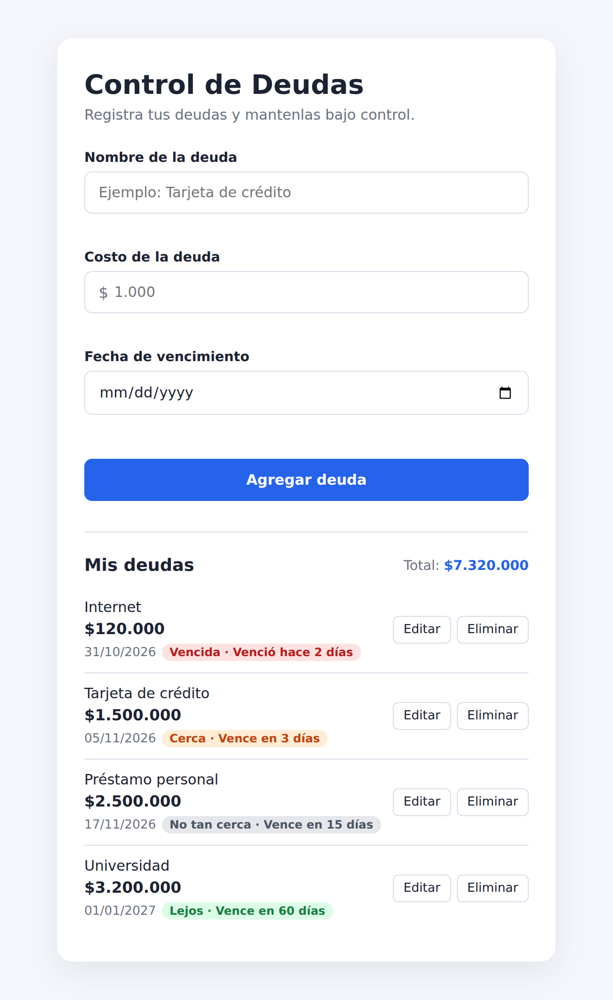

# Control de Deudas

Aplicación web sencilla para registrar deudas, ver cuánto falta para que venzan y mantenerlas organizadas. Está hecha con HTML, CSS y JavaScript puro, sin frameworks, sin backend y sin pasos de instalación.

**Versión actual:** 1.0.0 — primera versión.
**Versión 2:** planeada, con cuentas de usuario. Todavía no está implementada.



## Descripción del proyecto

Este es un proyecto personal de Juan Jose Yepes. Nació como una forma práctica de llevar el control de las deudas sin depender de una hoja de cálculo o de una aplicación con registro obligatorio.

En esta primera versión todo funciona en el navegador: las deudas se guardan localmente y no se envían a ningún servidor. La idea a futuro es que el proyecto pueda crecer y que otras personas puedan usarlo con sus propias cuentas, manteniendo la misma sencillez.

## Estado y versiones

| Versión | Estado | Qué incluye |
| --- | --- | --- |
| v1.0.0 | Actual | Registro local de deudas con nombre, costo y fecha; edición, eliminación, orden automático y estados por color. |
| v2.0.0 | Planeada | Cuentas de usuario para que cada persona registre y consulte sus propias deudas. |

La versión 2 todavía no existe. Para hacerla realidad se necesitaría un backend, autenticación y una base de datos; nada de eso está implementado en este momento. Todo lo que aparece en este README como "planeado" es una idea, no una función disponible.

## Funcionalidades actuales

- Registrar una deuda con **nombre**, **costo** y **fecha de vencimiento**.
- Formatear el costo automáticamente con puntos de miles: `1000` se convierte en `1.000`.
- Validar los datos antes de guardar:
  - Nombre de al menos 4 caracteres, sin contar espacios al inicio y al final.
  - Costo de al menos $1.000.
  - Fecha obligatoria, de hoy en adelante.
- Calcular y mostrar la cuenta exacta de días: `Vence hoy`, `Vence en 50 días`, `Venció hace 2 días`.
- Clasificar cada deuda con un estado y un color:
  - **Vencida:** rojo.
  - **Cerca:** naranja, de 0 a 7 días.
  - **No tan cerca:** gris, de 8 a 30 días.
  - **Lejos:** verde, 31 días o más.
- Ordenar la lista de la fecha más próxima a la más lejana; las vencidas aparecen primero.
- Editar el nombre, el costo y la fecha de una deuda.
- Eliminar una deuda después de pedir confirmación.
- Mostrar el total acumulado de todas las deudas.
- Guardar los datos en el navegador con `localStorage`.

## Tecnologías

- **HTML5** para la estructura.
- **CSS3** para los estilos y los colores de estado.
- **JavaScript puro** para la lógica, la validación y el manejo del DOM.
- **`localStorage`** para guardar los datos.
- **`Date`** y `Date.UTC` para calcular los días restantes sin errores de zona horaria.

No se usan frameworks, librerías, CDNs, servidores ni herramientas de build.

## Estructura del proyecto

```text
/
├── index.html            # Estructura de la página y formulario
├── css/
│   └── styles.css        # Estilos, tarjetas y colores de estado
├── js/
│   └── app.js            # Validación, fechas, orden, edición y guardado
├── docs/
│   └── screenshot.png    # Captura de pantalla usada en este README
├── AGENTS.md             # Reglas internas para trabajar en el proyecto
├── MEMORY.md             # Notas breves de desarrollo y decisiones
└── README.md             # Este archivo
```

`AGENTS.md` y `MEMORY.md` son documentación de apoyo para el desarrollo; no forman parte de la aplicación que ve el usuario.

## Cómo ejecutarlo

La aplicación no necesita instalación. Hay dos formas de abrirla:

**Opción 1: abrir el archivo directamente**

Abre `index.html` en el navegador.

**Opción 2: usar un servidor local**

Desde la raíz del proyecto:

```bash
python3 -m http.server 8000
```

Luego abre <http://127.0.0.1:8000> en el navegador.

> **Importante:** `localStorage` está asociado al origen y al puerto. Si abres la aplicación desde otra URL o otro puerto, verás una lista vacía. Usa siempre la misma dirección para conservar las deudas.

## Cómo se usa

1. Escribe el **nombre** de la deuda.
2. Escribe el **costo**. Los puntos de miles se agregan automáticamente.
3. Elige la **fecha de vencimiento**. Debe ser hoy o una fecha posterior.
4. Pulsa **Agregar deuda**.
5. Usa los botones **Editar** o **Eliminar** de cada deuda de la lista.

### Estados de una deuda

| Estado | Días restantes | Color |
| --- | --- | --- |
| Vencida | Menos de 0 | Rojo |
| Cerca | 0 a 7 | Naranja |
| No tan cerca | 8 a 30 | Gris |
| Lejos | 31 o más | Verde |

La lista se ordena por días restantes de menor a mayor. Si dos deudas tienen la misma fecha, se respeta el orden en que fueron creadas.

## Datos y privacidad

- Las deudas se guardan en el `localStorage` del navegador con la clave `"debts"`.
- Cada deuda se guarda así: `{ id, name, cost, dueDate }`.
  - `cost` es un número.
  - `dueDate` tiene el formato `"YYYY-MM-DD"`.
- Los datos no salen del navegador: no hay servidor, cuentas ni envío de información.
- Si se borran los datos del navegador, las deudas se pierden.

Para empezar desde cero: abre DevTools (`F12`), ve a **Application → Local Storage**, selecciona el origen de la aplicación y elimina la clave `"debts"`.

## Limitaciones conocidas

- No hay cuentas de usuario ni sincronización entre dispositivos.
- Las deudas solo existen en el navegador y en el equipo donde se registraron.
- Borrar el almacenamiento del navegador elimina la información.
- No hay backend ni base de datos.
- No hay pruebas automatizadas; la aplicación se prueba manualmente en el navegador.
- Si un cambio no aparece después de actualizar el código, puede ser caché del navegador. Haz una recarga forzada con `Ctrl + Shift + R`.
- El proyecto todavía no tiene una demostración publicada en internet.

## Roadmap

### Versión 2 (planeada)

- Registro e inicio de sesión de usuarios.
- Cada usuario ve únicamente sus propias deudas.
- Backend y base de datos para guardar la información.
- Las mismas funciones de la versión 1, pero asociadas a cada cuenta.

### Ideas para más adelante

Estas ideas no están confirmadas ni implementadas; solo son posibilidades:

- Exportar e importar deudas.
- Recordatorios de vencimiento.
- Categorías para organizar las deudas.
- Registro de pagos parciales.
- Gráficos y resúmenes.
- Modo oscuro.
- Uso sin conexión (PWA).
- Pruebas automatizadas.

## Lo que aprendí

Este proyecto también sirvió como ejercicio de aprendizaje:

- Manipular el DOM y crear elementos desde JavaScript.
- Validar formularios y mostrar mensajes de error claros.
- Guardar y recuperar datos con `localStorage`.
- Calcular diferencias entre fechas y evitar problemas de zona horaria usando `Date.UTC`.
- Ordenar una lista con varios criterios.
- Organizar el código en funciones pequeñas con nombres claros.
- Mantener una aplicación sencilla sin agregar dependencias innecesarias.

## Autor y comentarios

**Autor:** Juan Jose Yepes.

Es un proyecto personal que puede crecer con el tiempo. Las sugerencias, comentarios y feedback son bienvenidos: ayudan a mejorar la aplicación y a decidir qué debería incluir la versión 2. Si tienes una idea, puedes compartirla directamente con el autor.

## Reportar errores o sugerencias

Cuando el proyecto esté publicado en GitHub, usa la pestaña **Issues** y elige una de las plantillas:

- **Reportar un error:** para contar qué falló, cómo reproducirlo y qué esperabas que ocurriera.
- **Sugerencia o mejora:** para compartir una idea o una posible mejora.

Antes de abrir un reporte:

- Busca si el problema o la sugerencia ya existen.
- Si algo no aparece después de un cambio, prueba una recarga forzada con `Ctrl + Shift + R`.
- No incluyas deudas reales, nombres, montos ni capturas con datos personales. Usa datos de ejemplo.

Las plantillas están en `.github/ISSUE_TEMPLATE/`.

## Licencia

Copyright (c) 2026 Juan Jose Yepes. Todos los derechos reservados.

Este proyecto se comparte con fines de consulta y aprendizaje. No se permite copiar, modificar, distribuir ni reutilizar el código sin el permiso expreso del autor.

La licencia no impide enviar sugerencias, comentarios o feedback sobre el proyecto. Tampoco impide ver el código para entender cómo funciona.

Si en el futuro el proyecto se publica con otra licencia, esta sección se actualizará.
